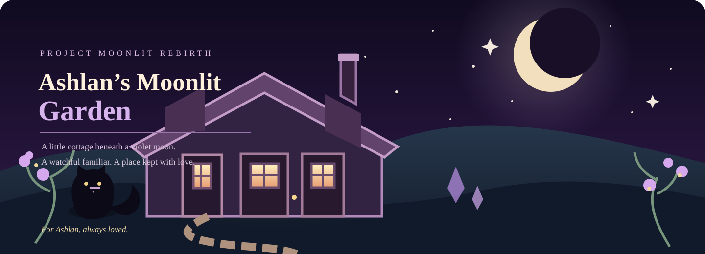
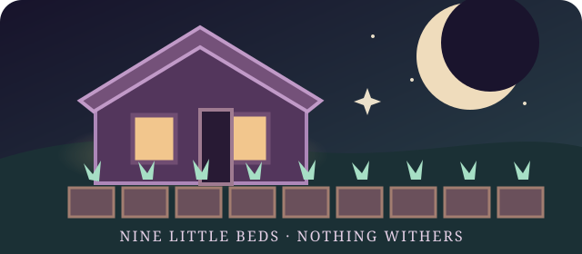
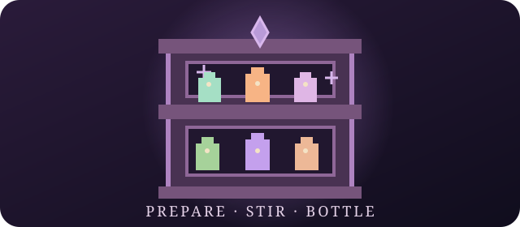
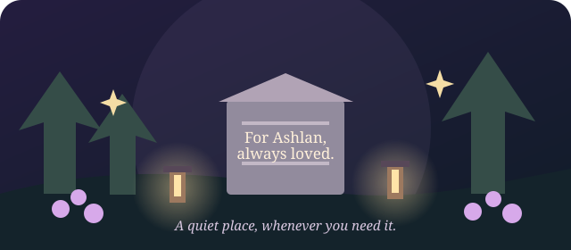

<div align="center">



# ASHLAN’S MOONLIT GARDEN
### A native Android garden, grown from a private original

**PROJECT MOONLIT REBIRTH · v1.0.0 · ANDROID DEVELOPMENT BUILD**

[](https://github.com/ShamelesAbyss/Ashlans-Moonlit-Garden-Android/actions/workflows/android.yml)
[](#compatibility)
[](#privacy--promises)
[](LICENSE.txt)


*A small, gentle place beneath a crescent moon — rebuilt in Kotlin, for Ashlan, always loved.*

</div>

---

> **A note about this first public build.** This is a fresh native Kotlin/Jetpack Compose project with a distinct Android application ID. It is a development edition—not a production-signed store release. The original music and cover art are intentionally absent from the public tree and APK while their public redistribution rights remain undocumented. The native offline jukebox foundation is present, but the published playlist is empty. See [the rights audit](docs/MUSIC-RIGHTS.md).

## A garden after dusk

The original private repository remains private and untouched. This new repository has its own history and a native implementation: Compose screens and controls, a Canvas-rendered pixel garden, local DataStore saves, Android backup pickers, and an offline Media3 player foundation. No WebView game, advertising, analytics, account, or cloud save is included.

<div align="center">
<table>
<tr>
<td align="center"><br><b>THE COTTAGE GARDEN</b><br><sub>Nine beds, three moonlit blooms, and a warm cottage window.</sub></td>
<td align="center"><br><b>NETTLE, NEARBY</b><br><sub>A familiar face, small mysteries, and a place to rest.</sub></td>
</tr>
<tr>
<td align="center"><br><b>THE VIOLET CABINET</b><br><sub>Six recipes, gathered ingredients, and a three-step brew.</sub></td>
<td align="center"><br><b>THE MEMORIAL GLADE</b><br><sub>A quiet place for flowers, lanterns, stars, and words of your own.</sub></td>
</tr>
</table>
</div>

*The panels above are original README illustrations, not screenshots of a running app. Native gameplay screenshots will be added only after a real emulator or device capture is available; no mockup is presented as app evidence.*

## What is in the garden

| Place | What you can do |
|---|---|
| **Cottage garden** | Tend nine beds; grow Moonmint, Emberbell, and Ashlan’s Bloom; select seeds, plant, water, and gather. Nothing withers. Rain waters growing beds. |
| **Hushwood** | Search eight Ghostcap patches and four Duskthorn sprigs; forage refreshes with a new evening. |
| **Violet Cabinet** | Choose among six fictional potions and poisons, gather ingredients, then Prepare → Stir → Bottle. Ingredients are spent only at bottling. |
| **Nettle & Bramble** | Speak with and care for Nettle, bring her a Moonmint, play together, visit Bramble’s seed stall, and improve soil. |
| **Memory glade** | Place flowers, lanterns, and paper stars. Ashlan’s Bloom brings the moonflowers awake. The journal is yours to write; the game does not invent personal memories. |
| **Jukebox** | A local Media3 playback foundation with play/pause, track navigation, selection, seeking, shuffle, repeat, and a separate music volume. The public playlist is empty pending rights confirmation. |

The rules preserve the original crop timings (22 / 32 / 42 active seconds), nine-bed layout, woodland nodes, six recipes, three soil upgrades, progression, and version-1 save fields. See the [evening guide](USER-GUIDE.md) for controls and details.

## Install the development APK

When a verified public development release is available, download the APK and its matching checksum from [GitHub Releases](https://github.com/ShamelesAbyss/Ashlans-Moonlit-Garden-Android/releases). This repository does not claim an APK or release exists until one appears there.

The development APK is **debug-signed and debuggable**, not production-signed. Its signing identity is not a permanent update key; Android may reject installing a later build over an earlier one. Export a JSON backup before uninstalling or switching builds. The app ID is `com.shamelesabyss.ashlansmoonlitgarden.native`, distinct from the earlier edition so the two can coexist.

Minimum Android version: **Android 8.0 (API 26)**. Target SDK: **35**. Phone portrait/landscape and wider/foldable layouts are served by adaptive Compose layouts; device-specific foldable validation is not claimed unless it appears in CI or test evidence.

## Bring an existing garden with you

1. In the older game, export its version-1 JSON save.
2. Install the native app separately; do not uninstall the earlier game first.
3. Open **More → Settings → Import JSON backup** and select the file in Android’s system picker.
4. Review and confirm the import. The current journal is merged by exact date-and-text match; it is not discarded. A local pre-import recovery copy is retained.
5. Keep the original backup somewhere you control. **Restore pre-import recovery copy** can roll progress back while preserving journal pages added since.

Malformed or unsupported files are rejected before replacing current progress. See [migration and play guidance](USER-GUIDE.md#journal-and-privacy).

## Sound, rights, and quiet motion

The original MP3 and its cover were found in the private reference tree. The available materials do not establish the full composition/recording chain, a public-redistribution grant, the generation-tool terms, or the cover’s provenance and distribution rights. They remain private; prior inclusion in a private/test build is not evidence of public rights. No replacement song is bundled. Read the specific findings in [`docs/MUSIC-RIGHTS.md`](docs/MUSIC-RIGHTS.md).

Locally generated ambience and interaction sounds are separate from music and work offline. Music, ambience, and effect volumes are separate settings. The garden Canvas honors the in-game reduced-motion setting; the jukebox lights and notes respond to actual playback state. Playback is paused when the app leaves the foreground and is never auto-started on return.

## Privacy by design

- No `INTERNET` permission is declared in the Android manifest.
- No accounts, cloud saves, analytics, advertising, or subscriptions.
- Saves, journal entries, drafts, and recovery data stay in private app storage.
- User-chosen imports and exports use Android’s Storage Access Framework.
- Automatic Android cloud backup is disabled; export and keep your own backup copy.

More: [Privacy statement](PRIVACY.md) · [All-rights-reserved notice](LICENSE.txt) · [Contribution boundaries](CONTRIBUTING.md).

## Build and verify

Requires a JDK 17+ and Android SDK Platform 35 / Build Tools 35.0.0. From the repository root:

```sh
./gradlew --no-daemon :app:testDebugUnitTest
./gradlew --no-daemon :app:assembleDebug
```

The installable development APK is `app/build/outputs/apk/debug/app-debug.apk`. CI builds and verifies this debug-signed development variant. `:app:assembleRelease` is an optional local build-validation task; when no production signing key is configured, its output is unsigned and must not be distributed as a production release.

The development environment used for the first build attempt is ARM64, while Android Gradle Plugin’s AAPT2 binary in the installed SDK is x86-64; resource processing therefore cannot be verified locally there. The x86 GitHub Actions runs provide authoritative build/test results. Earlier runs passed the JVM unit suite and debug APK checks, and one verified emulator installation plus foreground launch. The Compose instrumentation test is compiled but has not completed an emulator run; prior software-emulated TCG attempts failed before any test completed. The current device smoke is an ADB install/foreground-launch check plus a raw screenshot and logcat capture after a settle period—not an interaction test. Review each image before presenting it as gameplay; captures with a launch splash or system dialog are not clean gameplay screenshots.

- [Build and CI details](BUILD.md)
- [Evening guide](USER-GUIDE.md)
- [Privacy](PRIVACY.md)
- [Music distribution-rights audit](docs/MUSIC-RIGHTS.md)
- [Changelog](CHANGELOG.md)
- [Contributing](CONTRIBUTING.md)

## Project shape

```text
app/src/main/java/…/data/       v1 JSON model, validation, local persistence
app/src/main/java/…/domain/     pure game rules, recipes, progression, view model
app/src/main/java/…/ui/         Jetpack Compose screens and native Canvas world
app/src/main/java/…/audio/      local Media3 player + separate SoundPool effects
app/src/main/assets/            procedural local soundscape; empty music manifest
app/src/main/res/                original garden identity, adaptive icons, jukebox art
```

The public repository began from a fresh tree: it does not copy the private repository’s `.git` history, private saves, journal data, credentials, or signing keys. The private project remains the definitive reference and stays private.

---

<div align="center">

### FOR ASHLAN, ALWAYS LOVED

*A moon overhead. A little cottage glowing in the distance. Nettle wandering close by. A quiet glade whenever it is needed.*

**Project Moonlit Rebirth begins here.** 🌙

</div>
